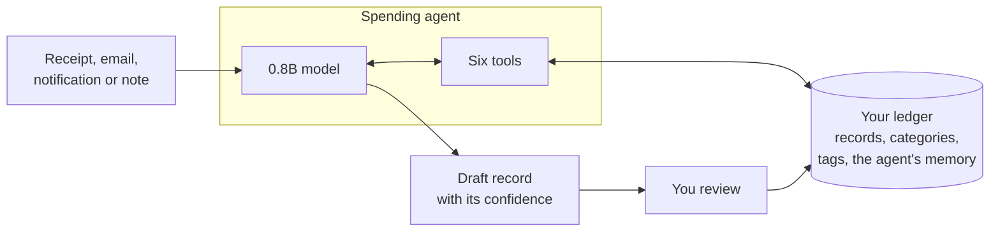
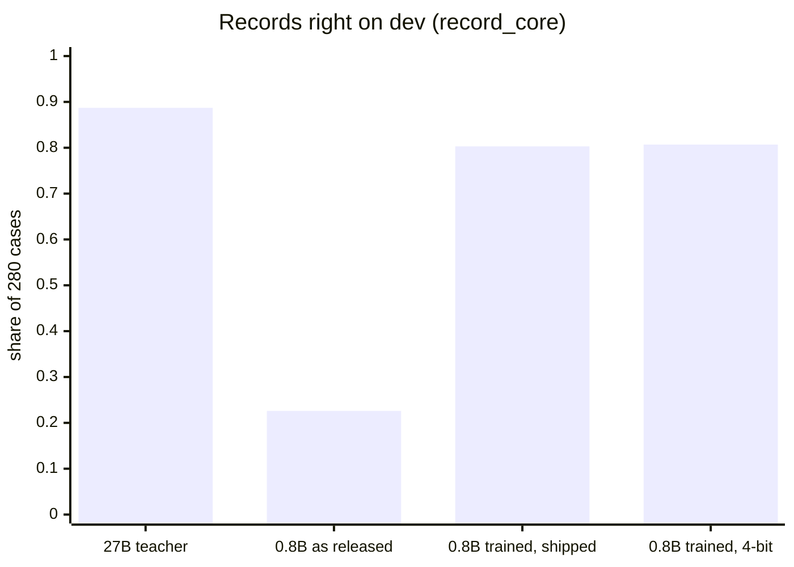
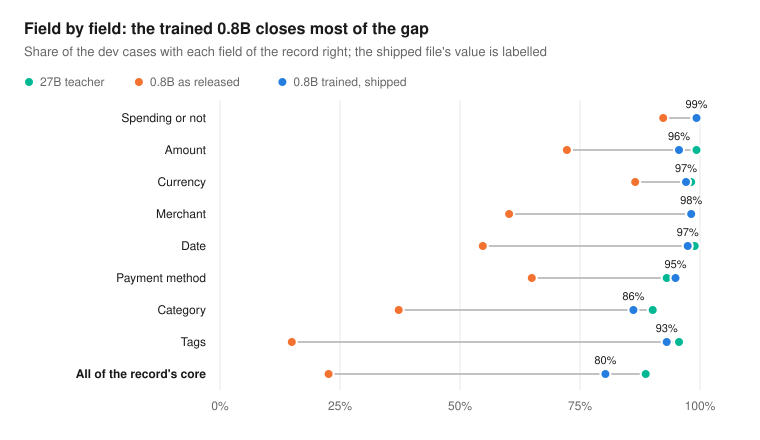
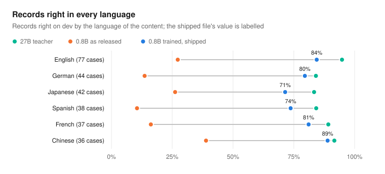
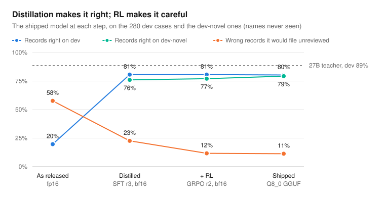
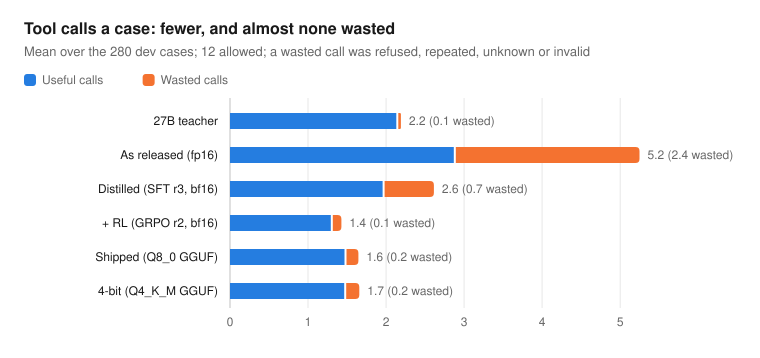
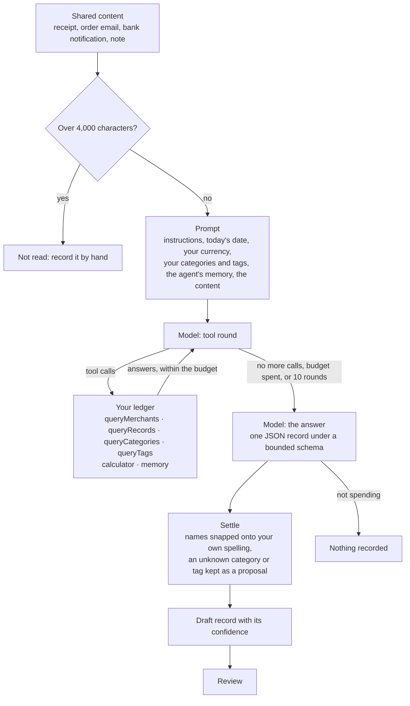

# Cost spending agent

The agent behind Cost, a spending tracker for iPhone and Mac. You share a
receipt, an order email, a bank notification or a quick note, and the agent
turns it into a spending record: merchant, amount, currency, date, payment
method, category and tags, with how confident it is.

**Models on Hugging Face** (Qwen3.5-0.8B trained for this agent, as GGUF):

- [kurexi/cost-0.8b-q8](https://huggingface.co/kurexi/cost-0.8b-q8):
  `Q8_0`, 0.81 GB, the one the app ships.
- [kurexi/cost-0.8b-q4_k_m](https://huggingface.co/kurexi/cost-0.8b-q4_k_m):
  `Q4_K_M`, 0.53 GB, smaller, a little weaker on names it has never seen.

How to run them: [USAGE.md](USAGE.md).

It is built for a model small enough to ship with the app, so it doesn't
rely on what the model remembers. It looks things up in your own records
first (how you filed this merchant before, which categories and tags you
use, what it noted last time), and it never invents a category or tag:
anything new comes back as a proposal for you to accept.

## A 0.8B model does the job

A 27B model reads these well, but it can't ship with an app. So the 27B is
the teacher: Qwen3.5-0.8B is trained on its sessions, then with
reinforcement learning on the agent's own reward, and quantized to a GGUF
under 1 GB. The app ships it at 8 bits (`Q8_0`, 0.81 GB); the 4-bit file
(`Q4_K_M`, 0.53 GB) is shown beside it. The shipped model is published on
Hugging Face as [kurexi/cost-0.8b-q8](https://huggingface.co/kurexi/cost-0.8b-q8)
(`qwen3.5-0.8b-grpo-r2-q8_0.gguf`, the "0.8B trained, shipped" row below),
and the 4-bit one as [kurexi/cost-0.8b-q4_k_m](https://huggingface.co/kurexi/cost-0.8b-q4_k_m)
(the "0.8B trained, 4-bit" row).

All of them run the same agent on the same 280 cases (`dev`: receipts,
emails, bank and wallet notifications, notes and non-spending messages in
seven languages). `dev-novel` is the same mix with the merchants and item
names invented, so a score there can't come from having seen the shop
before. That is where the 4-bit file falls behind, and why the 8-bit one
ships.

- **Records right**: whether it is spending, the amount, the currency, the
  merchant and the category are all right.
- **Wrong records it would file unreviewed** is the safety number: the
  record was wrong but confident enough (0.8 or more, in one of your
  categories) that the app would have filed it without asking.
- **Tool calls** and **ran out of tool budget** show how the model uses
  the six tools below. A wasted call is one that was refused, repeated,
  unknown or invalid.

<!-- board:begin -->

| | weights | records right on `dev` | on `dev-novel` (names never seen) | wrong records it would file unreviewed | tool calls a case (wasted) | ran out of tool budget |
|---|---|---|---|---|---|---|
| 27B teacher | Qwen3.8-27B, FP8 | 89% (85%–92%) | not run | 18% | 2.2 (0.1) | 1% of cases |
| 0.8B as released | Qwen3.5-0.8B, Q8_0, 0.81 GB GGUF | 23% (18%–28%) | not run | 80% | 4.9 (2.5) | 38% of cases |
| 0.8B trained, shipped | Qwen3.5-0.8B, Q8_0, 0.81 GB GGUF | 80% (76%–85%) | 79% | 11% | 1.6 (0.2) | 6% of cases |
| 0.8B trained, 4-bit | Qwen3.5-0.8B, Q4_K_M, 0.53 GB GGUF | 81% (76%–85%) | 76% | 13% | 1.7 (0.2) | 5% of cases |
<!-- board:end -->

<picture>
  <source media="(prefers-color-scheme: dark)" srcset="eval/charts/fields-dark.svg">
  
</picture>

<picture>
  <source media="(prefers-color-scheme: dark)" srcset="eval/charts/languages-dark.svg">
  
</picture>

Every run, at every size, is in [eval/BENCHMARK.md](eval/BENCHMARK.md).

## Six tools, a small budget

The model has only these six tools, and every one of them reads the
user's own ledger or the agent's own notes. There is no web search and no
general tool use: anything the content doesn't say has to come from the
user's past records.

| tool | what it answers | calls a session |
|---|---|---|
| `queryMerchants` | a merchant as the user spells it, matched loosely enough for OCR ("TESCO STORES 3297" finds "Tesco"): how often they buy there, the categories they file it under, amounts, cards, the last date | 3 |
| `queryRecords` | past records by merchant, category, tag, a word, an amount or dates, grouped with counts, amounts and how regularly they recur | 4 |
| `queryCategories` | the user's categories by title, with the merchants and amounts under each | 3 |
| `queryTags` | the user's tags, whether each is an event (with its dates) or standing, and what is under it | 3 |
| `calculator` | one arithmetic expression, so the model never adds amounts in its head | 8 |
| `memory` | the agent's own notes, kept across sessions (at most 1,000 characters) | 2 reads, 1 edit |

At most 12 calls a session in all, over at most 10 model rounds. A
repeated query is answered from a cache with a note that it reveals nothing
new; a call past its limit is refused, and a second refusal ends the tool
phase.

## Trained on its own harness

The 0.8B isn't trained to use tools in general. It is trained on exactly
this agent: these six tools, this budget, these prompts and this answer
schema.

- **Distillation.** The teacher runs the agent over generated users, each
  with a ledger of past records, tags and memory. Every request the agent
  sent in a session the teacher got right is rebuilt by replaying the
  session through the same loop (the tool answers, refusals and compaction
  as the agent produced them) and rendered with the student's chat
  template exactly as the server renders it. So the student learns each
  next step from what the harness really shows it, including when to stop
  calling tools.
- **Reinforcement learning.** The student then plays whole sessions of the
  real loop: a fresh ledger, the real tools, the budget, compaction, and
  the answer sampled under the same JSON grammar the server enforces. Each
  session is graded by the evaluation's own grader. Every wasted call costs
  reward, and so does a wrong record confident enough to be filed without
  review.

The last two columns of the benchmark show the result: before training,
the 0.8B wastes calls and often spends its whole budget; after it, it
calls fewer tools than its teacher and rarely wastes one.

Step by step, distillation is what makes the 0.8B get records right, and
reinforcement learning is what makes it careful: it halves the wrong
records it would file without asking, and cuts the wasted calls. Turning
it into an 8-bit GGUF costs next to nothing.

<picture>
  <source media="(prefers-color-scheme: dark)" srcset="eval/charts/path-dark.svg">
  
</picture>

<picture>
  <source media="(prefers-color-scheme: dark)" srcset="eval/charts/tools-dark.svg">
  
</picture>

The charts are drawn from the graded runs by
[eval/charts.py](eval/charts.py).

## How a session runs

The model talks to any OpenAI-compatible server (llama-server, Ollama, LM
Studio, vLLM). Long sessions are compacted as they go, so a small context
window is enough.

## More

- [USAGE.md](USAGE.md): running the agent on your own ledger.
- [eval/README.md](eval/README.md): the evaluation suites, the grader, and
  how the 0.8B was distilled and trained.
